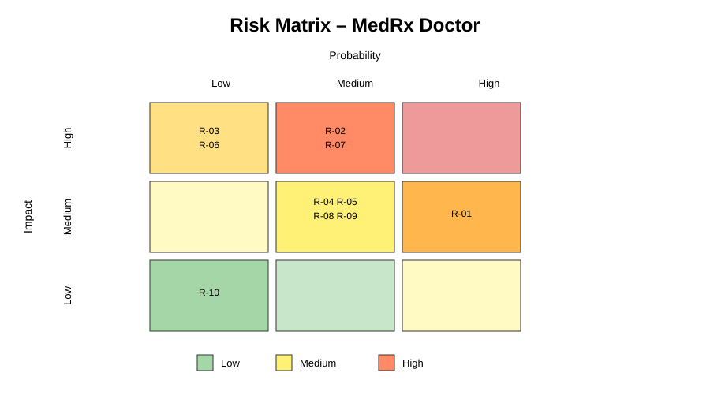

# Risk Register – MedRx Doctor Version

**Document owner:** MedRx team  
**Version:** 1.1  
**Date:** 2026-11-16  
**Status:** Active  
**Related:** Product Technical Specification v1.0 / v1.1, Lab 3 design work

## Purpose
This register identifies, analyses and tracks risks that could affect the delivery, quality or safety of the MedRx Doctor prototype. It is maintained throughout the project.

## Risk evaluation criteria
- **Probability:** Low / Medium / High
- **Impact:** Low / Medium / High (on schedule, quality, or user safety/trust)
- **Score:** Probability × Impact (qualitative)
- **Residual level:** remaining risk after the planned mitigation (Low / Medium / High)
- **Treatment:** Avoid / Mitigate / Transfer / Accept
- **Category:** Technical, Schedule, Quality, AI-safety, Process (all five covered)

## Risk Register

| ID | Category | Risk | Source | Prob. | Impact | Residual | Owner | Treatment | Mitigation / Notes | Status |
|----|----------|------|--------|-------|--------|----------|-------|-----------|--------------------|--------|
| R-01 | Technical | LLM provider returns HTTP 429 (rate limit) during a check | Free-tier Gemini/Groq quota | High | Medium | Medium | Backend | Mitigate | Retry with exponential backoff + circuit breaker; graceful DEGRADED message (FR-07). Fallback provider (Gemini primary, Groq secondary). | Open |
| R-02 | AI-safety | Model invents drug information when leaflet is missing (hallucination) | LLM behaviour | Medium | High | Medium | AI / Backend | Mitigate | Strict RAG grounding; refuse unknown drugs (FR-05); explicit “not found”; no free-form generation outside retrieved context. | Open |
| R-03 | AI-safety | Missed high-risk interaction (false negative) | Incomplete leaflet data or retrieval failure | Medium | High | Medium | AI / Domain | Mitigate | Prefer flagging risk when evidence is weak; cite leaflet source for every claim (NFR-02). Decision: accept some alert fatigue (see R-04) to reduce false negatives. | Open |
| R-04 | Quality | Excessive minor warnings (alert fatigue) | Broad interaction rules | Medium | Medium | Low | Product | Mitigate | Severity filtering; short summary first; full section on demand (FR-04). User feedback from INT-1. Trade-off with R-03 documented as a decision. | Open |
| R-05 | Technical | Response time exceeds acceptable threshold (>10 s) | Slow LLM or large context | Medium | Medium | Low | Backend | Mitigate | Limit number of drugs per check; cache frequent leaflets; timeout + DEGRADED path. Supports the time-limit decision record. | Open |
| R-06 | Process | API key exposure or accidental commit of `.env` | Development practice | Low | High | Low | All | Avoid | `.env` in `.gitignore`; keys only in local environment; no secrets in repository. | Open |
| R-07 | Schedule | Free-tier quota exhausted before demo / lab deadline | External provider policy | Medium | High | Medium | Backend | Mitigate | Monitor usage; secondary provider; offline/fake mode for testing (`FAKE_LLM_FAILURES`). | Open |
| R-08 | Quality | Incomplete or outdated leaflet data in the store | Data preparation | Medium | Medium | Low | Data | Mitigate | Use only public/fictional leaflets; document data limitations; clear “not found” for missing entries. | Open |
| R-09 | Process | Scope creep (patient-specific factors, EHR integration, etc.) | Stakeholder requests | Medium | Medium | Low | Product | Avoid | Explicit Won’t-have list in specification; defer special patient factors to future work. | Open |
| R-10 | Technical | Deployment or environment differences between team members | Local setup | Low | Low | Low | All | Mitigate | Documented setup in deployment diagram; shared `.env.example` (no real keys). | Open |
| R-11 | AI-safety | Prompt injection through leaflet text | Untrusted content in retrieved leaflets | Low | High | Low | AI / Backend | Mitigate | Treat leaflet text as data, not instructions; no direct inclusion of raw leaflet into system prompt; input validation on tool arguments. | Open |
| R-12 | AI-safety | Output that reads as medical advice | LLM phrasing | Medium | High | Medium | Product / AI | Mitigate | Explicit disclaimer in UI; language constrained to “according to the leaflet”; no diagnostic or dosage recommendations. | Open |
| R-13 | AI-safety | Physician approving without reading the evidence | Human workflow | Medium | High | Medium | Product | Mitigate | Approval gate requires confirmation; severity + leaflet quote shown before approve; log approver identity. | Open |

## Risk Matrix (3×3)

| Impact \ Probability | Low | Medium | High |
|----------------------|-----|--------|------|
| **High**             | R-06, R-11 | R-02, R-03, R-07, R-12, R-13 | — |
| **Medium**           | — | R-04, R-05, R-08, R-09 | R-01 |
| **Low**              | R-10 | — | — |

### Legend
- **High** (red zone): requires active mitigation and monitoring.
- **Medium**: mitigation planned, reviewed periodically.
- **Low**: accepted or lightly monitored.

### Visual matrix

## Category coverage
- Technical: R-01, R-05, R-10
- Schedule: R-07
- Quality: R-04, R-08
- AI-safety: R-02, R-03, R-11, R-12, R-13
- Process: R-06, R-09

## Open actions
1. Implement and test the retry + circuit breaker path (R-01, R-07).
2. Add explicit tests for unknown-drug refusal (R-02).
3. Review severity presentation with the team after first prototype (R-04 / R-03 trade-off).
4. Document the time-limit decision (R-05).
5. Add prompt-injection and medical-advice guardrails in the specification (R-11, R-12).

## Traceability
- R-01, R-07 → FR-07, guarded_server.py
- R-02 → FR-05, NFR-03
- R-03 → NFR-02
- R-04 → FR-04, INT-1
- R-05 → NFR-01, FR-08
- R-11, R-12, R-13 → AI failure modes FM-03, FM-08, FM-09

## Review
Next review: after first end-to-end prototype and guarded server exercises.

## Change log
- v1.1 (2026-11-16): Added Category and Residual columns. Added AI-safety risks R-11, R-12, R-13. Raised R-03 probability to Medium. Documented R-03/R-04 trade-off. Clarified Gemini/Groq as the two providers.
